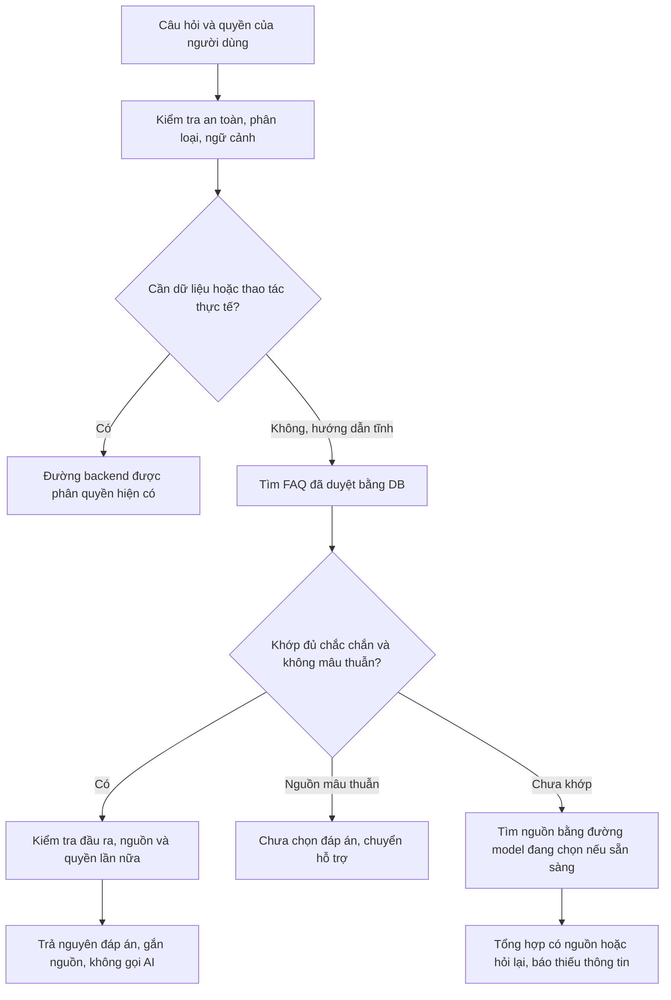

# Tri thức và đáp án FAQ của chatbot Google API

Cập nhật 24/11/2026. Đây là thay đổi code và migration; không tự công bố tài liệu hoặc áp dụng vào DB dev. Kết quả chạy được ghi tại `COMMON_KNOWLEDGE_IMPLEMENTATION_REPORT.vi.md`.

## Luồng xử lý



Trước thay đổi, đường hướng dẫn phải có index vector và embedding truy vấn thành công; sau đó mới đến bộ chọn FAQ. Hiện tại, FAQ chung được tìm trước hai bước này. FAQ phù hợp có thể trả khi không có key Google, embedding tắt hoặc index Google chưa ACTIVE. Tích hợp local và cơ chế đổi provider đã được gỡ; các kiểm tra quyền và nguồn vẫn bắt buộc.

Chatbot chỉ dùng Google Gemini khi cần model. Giữ cơ chế model/key dự phòng Google và báo lỗi có kiểm soát khi quota không còn; không còn nút chuyển nhà cung cấp.

## Nguồn nào được dùng trực tiếp

Tái sử dụng nguồn/tài liệu/chunk và quy trình duyệt hiện có, không có kho đáp án song song:

- Source ACTIVE, document READY, chunk READY; đúng document_version.
- Document có reviewed_at và reviewed_by, đang trong thời gian hiệu lực, là phiên bản READY mới nhất của document_key.
- Quyền phải phù hợp ở cả source, document và chunk. Tenant ở cả ba tầng phải phù hợp tenant do ứng dụng cung cấp; guest chỉ PUBLIC.
- Chỉ nội dung các block có mục cuối cùng là FAQ hoặc Câu hỏi ... thường gặp, nằm đúng phạm vi block của chunk, được xét cho đường chung. Nhãn đầu chunk không được dùng để tự công nhận các mục khác nằm cùng chunk. Mục con Ví dụ trong FAQ cũng không được coi là đáp án chuẩn.
- Chunk cũ thiếu start/end block hoặc thiếu block nguồn không đủ provenance cho đường chung; cần xử lý lại tài liệu qua quy trình hiện có khi được phép. Nhánh RAG cũ không bị biến thành dữ liệu đã duyệt tự động.
- Chỉ dòng hỏi đáp hoàn chỉnh `Câu hỏi? Câu trả lời` được trả trực tiếp. Không biến đoạn mô tả, ví dụ, đoạn nằm ngoài FAQ hoặc văn bản DRAFT thành đáp án chuẩn.
- Đáp án được giữ nguyên văn, không nhờ model viết lại. Các điều kiện trong cùng câu trả lời không bị cắt để vừa giới hạn context của model.

Việc duyệt tài liệu cũng là trách nhiệm duyệt nội dung FAQ của tài liệu đó. Nhãn FAQ và trạng thái READY không chứng minh nội dung đúng về nghiệp vụ. Người duyệt phải đối chiếu code, nguồn có thẩm quyền, điều kiện, phủ định, mốc thời gian, giới hạn quyền và các điều không được khẳng định. Câu trả lời của model Google không tự trở thành tài liệu đã duyệt.

Với mỗi FAQ, hợp đồng biên soạn cần xác định: câu hỏi/ý định, cách hỏi tương đương được chấp nhận, đáp án, ý bắt buộc, giới hạn/ngoại lệ, nguồn/phiên bản, phạm vi quyền, và khi nào hỏi lại hoặc chuyển hỗ trợ. Các bộ scenario/rubric hiện có tiếp tục là dữ liệu kiểm tra nội dung; không được dùng case ID để phân nhánh runtime. Đợt này không thêm bộ máy tự chứng nhận đầy đủ ý từ keyword.

## Ghép câu hỏi có kiểm soát

CanonicalQuestionKey tái sử dụng chuẩn hóa tiếng Việt. Chỉ thay đổi cách nhìn phục vụ so khớp, không thay câu gốc hoặc mã định danh dùng tra cứu nghiệp vụ. Giữ số, phủ định và phân biệt câu hỏi nguyên nhân, thời gian, số lượng/giá, định nghĩa, vị trí, lời khuyên với hướng dẫn.

Các biến thể đã hỗ trợ gồm có/không dấu, cách mở câu, viết tắt hạn chế và một số tương đương nghiệp vụ rõ ràng. Không ghép chỉ vì score cao hoặc nhiều từ chung. Không dùng fuzzy không giới hạn để làm câu hỏi ngắn khớp một đáp án bất kỳ.

Câu hỏi tiếp “vẫn lỗi/không được” có ngữ cảnh không được tự rút thành câu hỏi hướng dẫn ban đầu. Câu hỏi lỗi gọi hotline/gửi email không được đổi thành việc chỉ cung cấp số điện thoại/email. Các đường hỏi lại và đọc dữ liệu cá nhân hiện có vẫn đi trước FAQ.

Hai FAQ có cùng câu hỏi chuẩn hóa nhưng đáp án khác nhau tạo COMMON_ANSWER_CONFLICT; hệ thống chưa tự chọn một nguồn, không gọi model để phân xử. Câu hỏi quá rộng, chưa khớp hoặc số ứng viên vượt giới hạn được giữ là chưa có đáp án chuẩn; đường tìm nguồn tiếp theo vẫn có kiểm soát riêng. Chưa khớp không có nghĩa nội dung đã sai hoặc chắc chắn phải gọi model nếu resolver đã yêu cầu hỏi lại.

## Tìm kiếm và chi phí

CommonKnowledgeService chỉ phụ thuộc port DB, không có provider/embedding/model router/cache câu trả lời model. SQL dùng GIN search_vector_unaccent hiện có; không cần vector hoặc bản sao tài liệu riêng. Truy vấn lấy tối đa 33 ứng viên để phát hiện vượt cửa sổ 32; tối đa 24 term được tạo từ chữ/số, không nhận toán tử tsquery từ người dùng.

Đây là đường khớp bảo thủ, chưa thay thế tìm kiếm ngữ nghĩa. Không nạp toàn bộ corpus vào RAM mỗi request; đánh giá offline có đọc toàn bộ corpus thử và phải ghi rõ khác với truy vấn production.

Không thêm cache đáp án chuẩn trong đợt này. Mỗi lần dùng đều tìm nguồn hiện tại và kiểm tra lại trước trả. Như vậy không phát sinh cache chung vượt quyền hoặc dùng lại đáp án sau khi thu hồi tài liệu. Cache embedding/retrieval/câu trả lời model hiện có giữ khóa provider/index/mode/epoch và các điều kiện cũ; đường FAQ chung không đọc/ghi cache sinh câu trả lời.

## Phiên bản, kiểm tra lại và audit

source_snapshot chứa phiên bản policy, document ID/version, chunk ID và SHA-256 của nội dung/metadata duyệt. Không dùng index ID giả để biểu diễn tri thức chung. Snapshot không có prompt, key hoặc token bí mật.

Ngay trước công bố, CommonKnowledgeService.verify đọc lại điều kiện quyền/hiệu lực/phiên bản và fingerprint. Trong luồng thành viên, bước này nằm trong transaction ghi tin nhắn, giữ row share lock trên nguồn/tài liệu/chunk. Quyền của actor được giải lại trước bước kiểm tra. Chốt epoch hiện có vẫn nằm tại bước ghi tin nhắn.

Luồng guest kiểm tra lại nguồn trong transaction ngắn, sau đó wrapper kiểm tra epoch trước trả. Giới hạn thực tế: đó là kiểm tra tại thời điểm xử lý; không thể thu hồi một phản hồi đã gửi ra mạng hoặc ngăn quyền đổi sau khi transaction đã kết thúc. Không coi việc có fingerprint là cơ chế khóa vĩnh viễn mọi thay đổi trong DB.

Migration V20261124170000 thêm retrieval_method và source_snapshot vào audit hiện có:

| retrieval_method | Ý nghĩa |
| --- | --- |
| COMMON_FAQ | Đã chọn FAQ duyệt bằng DB, không có bước gọi model trong đường này |
| COMMON_CONFLICT | Phát hiện đáp án FAQ mâu thuẫn, chưa chọn câu trả lời |
| HYBRID | Đường tìm nguồn theo index/embedding hiện có |

Đường FAQ chung không tạo ai_run hoặc số HTTP giả. Audit giữ source IDs và snapshot; output/citation được liên kết khi thành viên công bố. Khi đầu ra bị từ chối hoặc nguồn đổi, không chuyển sang generation để cứu đáp án đã chọn.

HYBRID mô tả phương thức tìm nguồn, không khẳng định generation đã xảy ra: audit run/HTTP thực tiếp tục cung cấp bằng chứng tương ứng. Các đường dữ liệu backend và hỏi lại vẫn dùng audit/trạng thái hiện có; đợt này không thiết kế lại toàn bộ audit hội thoại.

## Cấu hình và giao diện

```ini
AI_COMMON_FAQ_ENABLED=true
```

Cờ này điều khiển lookup FAQ chung. AI_EMBEDDING_ENABLED chỉ điều khiển nhánh embedding, không tắt FAQ chung. Các cờ bật trợ lý toàn cục, opt-in dữ liệu hỗ trợ và phê duyệt model/quyền khi dùng AI vẫn được giữ nguyên. Tắt trợ lý vẫn chặn chat; API thử tìm tài liệu của quản trị có kiểm tra quyền riêng như trước.

PREPARING của provider nghĩa index AI chưa sẵn sàng; không đồng nghĩa mọi câu hỏi đều phải chờ. UI nói rõ FAQ đã duyệt vẫn có thể trả lời. Trang kiểm thử truy xuất hiển thị COMMON_FAQ là tìm DB dùng chung và không hiển thị score từ khóa như phần trăm chính xác cho kết quả này.

Không còn biến LM Studio trong cấu hình. Đường FAQ hợp lệ chỉ cần DB và không gọi model.

## Kiểm thử và tiếp tục nghiệm thu

- CanonicalFaqTest, CommonKnowledgeServiceTest: khớp bảo thủ, mâu thuẫn, thu hồi nguồn, không mất phủ định/số/ý hỏi tiếp.
- KnowledgeRetrievalServiceTest: FAQ trước index/embedding, không tương tác các port model/embedding trên đường chung, provenance đúng.
- GuestPublicAssistantServiceTest và AssistantOrchestratorTest: hai chế độ, PREPARING, nguồn đổi, citation và không generation.
- CommonKnowledgePersistenceTest: JPA/SQL trong DB Testcontainers riêng, quyền ba tầng, tenant, duyệt, phiên bản và hiệu lực. Không nạp toàn ứng dụng hoặc khởi tạo AI HTTP clients.
- CommonKnowledgeCorpusTest: 984 câu DRAFT fixture hiện có, domain resolver/matcher/output validator. Không coi là SQL ranking, model live hoặc công bố corpus.

Chạy từng nhóm tuần tự; không chạy compiler, browser, DB integration và kiểm thử Google live cùng lúc. Xem báo cáo để biết nhóm nào đã chạy thực tế.

Khi tài nguyên đủ, chạy DB integration trước, sau đó TypeScript/browser riêng. Chỉ chạy Google live khi có yêu cầu nghiệm thu, key/quota và tài nguyên phù hợp; giữ transcript lỗi, không dừng ứng dụng người dùng để lấy RAM. Đợt này không gọi Google API thật hoặc tiếp tục lượt Gemini cũ đang tạm dừng.

Google sau này cần kiểm tra riêng: embedding/index, tổng hợp từ nguồn, schema, điều kiện nghiệp vụ, fallback model/key và những câu đã thất bại. Có thể kiểm tra mẫu trọng yếu trước, nhưng không suy tỷ lệ chính xác toàn bộ Google từ kết quả FAQ chung.

Rollback tính năng chung: đặt AI_COMMON_FAQ_ENABLED=false rồi khởi động lại BE theo quy trình cấu hình; đường model giữ nguyên. Không xóa tri thức hoặc sửa migration đã áp dụng. Trước khi rollback binary, kiểm tra tương thích các cột audit và thay đổi từ đợt tích hợp provider trước.
