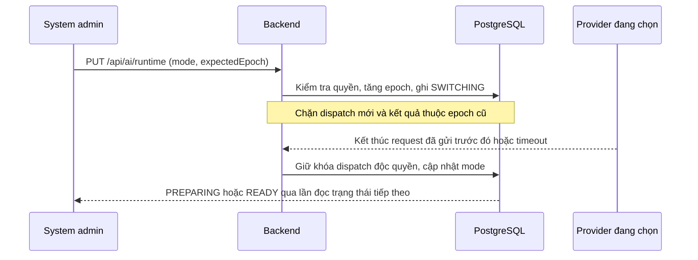

# Chatbot: chọn Qwen local hoặc Google API

Ngày cập nhật: 24/11/2026. Code và migration thuộc thay đổi này; chưa áp dụng vào DB dev.
Kết quả nghiệm thu được ghi riêng trong `QWEN_GOOGLE_IMPLEMENTATION_REPORT.vi.md`.

## Hai lựa chọn toàn hệ thống

Trang quản trị model AI của `system_admin` có hai nút **Qwen local** và **Google API**. Lựa chọn lưu trong DB, dùng chung cho mọi trình duyệt và giữ sau khi BE khởi động lại. Migration khởi tạo Google API để giữ hành vi trước đây.

| Chế độ | Viết câu trả lời | Tạo vector tìm tài liệu | Provider bị chặn |
| --- | --- | --- | --- |
| Qwen local | Qwen3.5-4B qua LM Studio | Qwen3-Embedding-0.6B qua LM Studio | Google AI |
| Google API | Các model Gemini đã cấu hình | Embedding Google đã cấu hình | LM Studio |

Không có AUTO hoặc fallback giữa hai bên. Google vẫn giữ cơ chế đổi model/key, cooldown và deadline trong provider của nó. Chọn Qwen không vô hiệu hóa đăng nhập Google, bản đồ hoặc dịch vụ ngoài chatbot AI.

Việc chọn Google không tự gỡ model hoặc đóng ứng dụng LM Studio: người dùng có thể sử dụng ứng dụng riêng. Chatbot không gửi request sang LM Studio trong chế độ đó.

## Cơ chế chuyển



`GET /api/ai/runtime` chỉ đọc DB. `PUT` yêu cầu `AI_MODEL_MANAGE_ALL` và role `system_admin`; quyền đơn lẻ của partner_admin không đủ. Đọc trạng thái dùng quyền `AI_MODEL_READ_ALL`. `expectedEpoch` ngăn hai trình duyệt ghi đè cấu hình cũ.

| Trạng thái | Ý nghĩa |
| --- | --- |
| SWITCHING | Đang chờ request cũ rút hết; cả hai provider đều bị chặn với dispatch mới |
| PREPARING | Đã chọn provider mới, chưa có index ACTIVE tương ứng; được phép chuẩn bị model/index của provider đã chọn |
| READY | Đã áp dụng lựa chọn và có index ACTIVE; không phải kết luận server model luôn khỏe |

Mọi HTTP AI thực trong Spring đi qua `AiProviderHttpClient`. Mỗi request giữ khóa advisory shared trong PostgreSQL; bước chuyển cần khóa exclusive. Khóa tồn tại ở DB nên áp dụng cả khi có nhiều JVM. Local có thêm khóa inference exclusive, tối đa một request local giữa các JVM; khi bận trả mã lỗi riêng thay vì xếp hàng vô hạn.

Request đã ra mạng trước thao tác chuyển không thể thu hồi tuyệt đối. UI không báo đã áp dụng trong khi request cũ còn giữ khóa. Timeout của adapter giới hạn thời gian chờ HTTP; nếu worker/DB chưa giải phóng được khóa, trạng thái vẫn đang chuyển, không báo thành công giả. Khi JVM mất kết nối, khóa session được PostgreSQL giải phóng. Không chỉnh tay trạng thái READY để bỏ qua bước rút request cũ.

Assistant job có snapshot mode/epoch do trigger DB gán. Job thuộc epoch cũ bị kết thúc với `AI_MODE_CHANGED`, không gửi lại câu trả lời dưới chế độ mới. Job mới xếp trong lúc chuyển mang epoch đích và chờ READY. Kiểm tra epoch trước xuất bản; khóa hàng cấu hình nằm trong transaction ghi tin nhắn/action card để đồng bộ với yêu cầu đổi chế độ. Cache câu trả lời phân biệt mode/epoch và index.

Xây index của provider bị tắt giữ checkpoint; không gọi provider khác để bù. Worker nhập tài liệu tạm dừng khi đổi mode hoặc local bận, giữ checkpoint trích xuất/chia đoạn và không tiêu hao retry provider cho việc đổi chế độ. Việc duyệt tài liệu kiểm tra embedding theo provider đang chọn.

## Cấu hình và khởi động LM Studio

LM Studio chạy riêng, không nhúng model vào Java. FE chỉ gọi BE. Không đặt token LM Studio hoặc key Google ở biến `VITE_*`.

Các giá trị mẫu trong `.env.example` được ánh xạ ở `application.yaml`:

```ini
LM_STUDIO_BASE_URL=http://127.0.0.1:1234/v1
LM_STUDIO_API_KEY=
LM_STUDIO_CHAT_MODEL=qwen3.5-4b
LM_STUDIO_EMBEDDING_MODEL=text-embedding-qwen3-embedding-0.6b
LM_STUDIO_CONNECT_TIMEOUT=2s
LM_STUDIO_GENERATION_TIMEOUT=30s
LM_STUDIO_EMBEDDING_TIMEOUT=15s
LM_STUDIO_CONTEXT_TOKENS=2048
LM_STUDIO_MAX_OUTPUT_TOKENS=512
LM_STUDIO_MAX_INPUT_BYTES=1200
LM_STUDIO_ALLOW_QWEN_MATRYOSHKA_768=true
```

Các API model ID trên đã được xác nhận bằng CLI trên máy này; không suy từ tên hiển thị. Thay ID khi cấu hình runtime thực tế thay đổi. Không sửa/xóa các biến GEMINI hiện có. Nếu bật xác thực LM Studio, giữ token ở cấu hình BE ngoài source control.

Với BE Windows, mở Model Server, bind `127.0.0.1`, port 1234. Lệnh CLI tương đương cho người vận hành:

```powershell
lms server start --bind 127.0.0.1 --port 1234
lms ps --json
```

Profile đã thử: Qwen chat context 2048, parallel 1; embedding context 8192, CPU, parallel 1. CLI nạp embedding nếu cần:

```powershell
lms load text-embedding-qwen3-embedding-0.6b --gpu off --context-length 8192 --parallel 1 --identifier text-embedding-qwen3-embedding-0.6b --yes
```

BE trong Docker Desktop dùng `http://host.docker.internal:1234/v1`. LM Studio phải bind địa chỉ host mà container truy cập được, với firewall giới hạn phù hợp. `127.0.0.1` trong container trỏ về container. Adapter chỉ cho phép các host local đã định trước, không theo redirect và không nhận URL/model từ người gửi chat.

BE khởi động được khi LM Studio đang tắt. Chọn Qwen không đòi key Google hợp lệ. Các cờ bật trợ lý, cho phép dữ liệu hỗ trợ ở chế độ UNPAID, phê duyệt model và quyền dữ liệu hiện có vẫn áp dụng cho cả hai bên.

## Chuẩn bị model và index local

1. Bật Model Server, nạp hai model với giới hạn tài nguyên phù hợp.
2. Trong trang quản trị AI, chọn **Qwen local**, chờ kết thúc SWITCHING. Chưa có index local sẽ hiện PREPARING.
3. Đồng bộ catalog của chế độ đang chọn. Adapter chỉ nhận hai ID được cấu hình; không tự duyệt mọi model đã tải.
4. Thao tác này đăng ký model local ở CANDIDATE. Người quản trị chủ động kiểm tra/kích hoạt cấu hình SUPPORT_CHAT và EMBEDDING. Rollout ACTIVE tính riêng từng provider/use case.
5. Chỉ dùng tài liệu đã được duyệt theo quy trình hiện có. Tạo phiên bản index với cấu hình embedding local, xây index, kiểm tra coverage/checksum và kích hoạt bằng quyền tương ứng.
6. Kiểm thử câu có dấu, không dấu, keyword, hỏi tiếp và kiểm tra quyền nguồn. PREPARING chuyển READY khi có index ACTIVE tương ứng.
7. Muốn quay lại Google, chọn **Google API** và chờ hoàn tất chuyển. Cấu hình và index Google đã có được giữ nguyên.

Không tự publish tài liệu DRAFT hoặc nhập corpus vào DB dev khi chạy harness. Harness live dùng PostgreSQL Testcontainers riêng. Không gắn DB dev vào test profile.

## Vector và phiên bản

Schema hiện lưu vector 768 chiều. Qwen dùng snapshot prompt `qwen-qa-mrl768-v1`, format truy vấn có chỉ dẫn retrieval; tài liệu không thêm chỉ dẫn query. Cả query/tài liệu dùng cùng phép giảm chiều và chuẩn hóa L2.

Qwen công bố MRL cho dòng embedding, cho phép chọn số chiều trong khoảng hỗ trợ. Adapter chỉ nhận vector 768 hoặc trường hợp rõ ràng Qwen3-Embedding-0.6B trả 1024, lấy 768 chiều đầu rồi L2. Không đệm vector, không dùng phép này cho model khác, không coi cùng số chiều là cùng không gian vector. Xem [model card của Qwen](https://huggingface.co/Qwen/Qwen3-Embedding-0.6B-GGUF).

Mỗi provider có một index ACTIVE riêng. Dữ liệu gắn `index_version_id`, provider, model, dimension, prompt/chunker và checksum. Kích hoạt hoặc rollback một bộ không retire bộ của provider còn lại. Không tái sử dụng staged vector chỉ vì model ID trùng nếu provider khác.

Khi đổi model, quantization, runtime/template hoặc profile giảm chiều, cần đánh giá lại provenance và xây phiên bản index mới phù hợp; không sửa nhãn để dùng lại vector cũ.

## Context và lỗi vận hành

Google giữ gói prompt/deadline cũ. Qwen có gói gọn riêng, 512 token đầu ra, giới hạn đầu vào 1200 byte và khoảng dự phòng cho template. Các đoạn bằng chứng được chọn nguyên đoạn; đoạn không vừa bị bỏ, không cắt mất phủ định hoặc điều kiện. Đầu vào embedding giới hạn 8000 byte với profile embedding context 8192. Giới hạn byte là biện pháp bảo thủ, không thay thế đo token và nghiệm thu nội dung.

Request API chủ động tắt thinking; không dựa vào nút Think trong chat riêng của LM Studio. JSON schema nằm ở `response_format`; câu bị cắt, JSON sai hoặc reasoning nội bộ không được xuất thẳng ra chat. Metadata GET thành công không chứng minh inference hoạt động. Không có vòng sinh liên tục để kiểm tra sức khỏe. Xem [structured output](https://lmstudio.ai/docs/developer/openai-compat/structured-output) và [embedding API](https://lmstudio.ai/docs/developer/openai-compat/embeddings).

| Mã | Hướng xử lý |
| --- | --- |
| LOCAL_SERVER_UNAVAILABLE | Kiểm tra Model Server, địa chỉ host/container và port |
| LOCAL_AUTH_FAILED | Kiểm tra token BE; không ghi token vào log |
| MODEL_NOT_FOUND / LOCAL_MODEL_NOT_READY | Kiểm tra đúng ID và trạng thái nạp model |
| LOCAL_OUT_OF_MEMORY | Giảm tải/context/offload hoặc gỡ model không dùng trong ứng dụng LM Studio |
| LOCAL_BUSY | Chờ yêu cầu đang xử lý; không mở thêm song song để ép chạy |
| LOCAL_TIMEOUT | Kiểm tra tốc độ và tài nguyên; không tự gọi Google để cứu |
| LOCAL_CONTEXT_LIMIT | Dùng profile/ngân sách phù hợp, không cắt điều kiện nghiệp vụ |
| LOCAL_RESPONSE_TRUNCATED / INVALID_RESPONSE_SCHEMA | Không đưa phản hồi dở dang lên chat |
| LOCAL_TOOL_UNSUPPORTED | Adapter local hiện chỉ hỗ trợ sinh câu trả lời có nguồn; không giả lập tool đã thành công |
| AI_MODE_CHANGED | Kết quả hoặc job thuộc chế độ cũ; không công bố lại |

Luồng backend trực tiếp đã được kiểm soát quyền vẫn giữ nguyên. Adapter local chưa ánh xạ vòng tool calling tương thích OpenAI; yêu cầu đi vào nhánh cần tool của model phải kết thúc an toàn. Không xem đây là bằng chứng đã đạt toàn bộ chức năng tool ở Google.

## Nhật ký, kiểm thử và rollback

`ai.runtime_mode_events`: người đổi, mode trước/sau, epoch, thời điểm và kết quả. `ai.provider_http_calls`: lượt HTTP thực, provider/epoch/loại tác vụ/status/độ trễ. Không ghi key, bearer token hoặc nội dung chat vào bảng đếm HTTP. FAQ/cache không tính là model call.

Dùng các test `AiRuntimeIsolationIntegrationTest`, `AiRuntimeModeServiceTest`, `LmStudioWireMapperTest`, `LocalGroundedProfileTest`, kiểm thử quản trị và bộ hồi quy Gemini. Integration test dùng server HTTP có bộ đếm thật, PostgreSQL riêng, kiểm tra request đang chạy, khóa giữa hai instance và không xuất bản kết quả cũ.

Live opt-in riêng, không tiếp tục lượt Gemini cũ đang tạm dừng:

```powershell
.\scripts\ai-knowledge\run-qwen-local-live.ps1 -OutputDirectory 'target/qwen-live-new-run'
```

Launcher kiểm tra RAM/Docker và không tự nạp model hoặc bật Docker; dùng JVM Maven chung để giảm bộ nhớ phụ. Guard là biện pháp phòng ngừa, không bảo đảm máy đủ tải. Harness dừng sau hai lỗi retrieval hạ tầng liên tiếp. Nếu dịch vụ chưa sẵn sàng hoặc máy thiếu RAM, dừng phần live và giữ chưa nghiệm thu.

Lưu transcript thất bại, hash input/config, source và profile; chấm nội dung riêng với kết quả protocol. Không dùng vector giả để công bố live. Không cộng kết quả Google vào điểm Qwen. Nếu không đủ mẫu hoặc không đạt ngưỡng đã công bố, giữ **chưa nghiệm thu chất lượng**.

Đo p50/p95/max riêng retrieval, generation và tổng; ghi RAM khả dụng, VRAM và tải BE/FE/Docker thật sự đang chạy. Không suy tốc độ từ file GGUF. Không gọi fixture API browser là UAT BE thật.

Rollback vận hành: bấm Google API, chờ xác nhận và kiểm tra index Google. Không xóa vector local hay sửa migration đã áp dụng. Nếu quay binary về bản chưa biết enum LM_STUDIO, cần kế hoạch tương thích schema/dữ liệu trước; chỉ đổi binary có thể làm bản cũ đọc lỗi.


## Bổ sung: FAQ chung độc lập index AI

Luồng FAQ đã duyệt được tìm bằng DB trước embedding và không cần index của provider. PREPARING không chặn toàn bộ assistant job nữa; SWITCHING vẫn chặn theo epoch. Các câu chưa có đáp án chuẩn tiếp tục cần đường index/model như trước. Xem [hợp đồng tri thức chung](COMMON_KNOWLEDGE_RUNTIME.vi.md) và [báo cáo đợt này](COMMON_KNOWLEDGE_IMPLEMENTATION_REPORT.vi.md).
