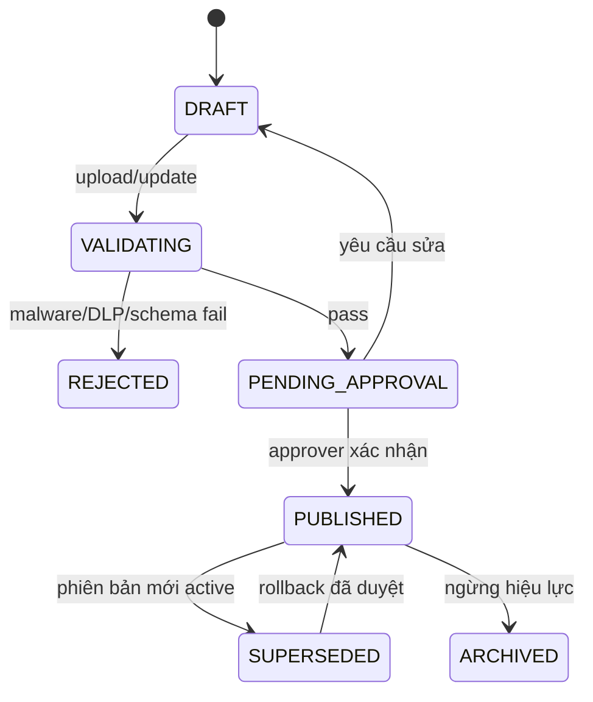

# Access scope và quản trị tài liệu tri thức

> Cập nhật đợt 1 — 19/11/2026: xem [bằng chứng/truy vết](evaluation/batch-01-traceability.md), [manifest](knowledge-manifest.json) và [báo cáo đợt 1](evaluation/batch-01-report.md). Baseline 14/09/2026 được giữ để truy vết; các nhận định runtime có delta dưới đây thay thế nhận định cũ tương ứng. Chưa tự phê duyệt/publish knowledge.

## Định nghĩa scope

| Scope | Đối tượng retrieval | Nội dung cho phép | Nội dung không được chứa |
|---|---|---|---|
| PUBLIC | Người chưa đăng nhập và mọi user | Hướng dẫn/chính sách đã công bố | PII, vận hành nội bộ, secret |
| CUSTOMER | Customer đã xác thực/được phép dùng widget | Hướng dẫn dành cho khách; không phải hồ sơ cá nhân | Dữ liệu một customer cụ thể |
| EMPLOYEE | Account có permission nghiệp vụ nhân viên phù hợp | SOP nhân viên đã phê duyệt | Dữ liệu khách hàng cụ thể, trừ tool runtime |
| ADMIN | Account có permission quản trị nội dung | Tài liệu quản trị được phép xem | Secret/hồ sơ cá nhân thô |
| TENANT_PRIVATE | Vô hiệu hóa trong phạm vi hiện tại | Không retrieval/publish | Mọi nội dung tenant-private; chỉ mở lại bằng decision/ADR multi-tenant mới |

Scope knowledge không thay thế permission. `ADMIN` không có nghĩa là role admin nào cũng đọc được; Backend phải kiểm tra permission tương ứng.

## Ma trận quản trị

| Hành động | Permission baseline | Điều kiện | Audit |
|---|---|---|---|
| Xem metadata | Target `AI_KNOWLEDGE_READ_ALL`; tạm dùng `MANAGE_ALL` đến khi migration hoàn tất | Không lộ content nếu thiếu preview permission | Bắt buộc |
| Preview nội dung | `AI_KNOWLEDGE_READ_ALL` hoặc quyền cao hơn theo permission composition | Scope hợp lệ; redact scan pass | Bắt buộc |
| Upload/chỉnh sửa draft | `AI_KNOWLEDGE_MANAGE_ALL` | MIME/size/malware/DLP validation | Bắt buộc |
| Publish | `AI_KNOWLEDGE_APPROVE_ALL` | Four-eyes bắt buộc ở production; người soạn khác người duyệt; validation pass | Bắt buộc |
| Archive | `AI_KNOWLEDGE_APPROVE_ALL` | Không xóa vật lý; giữ version/citation theo retention | Bắt buộc |
| Reindex | `AI_KNOWLEDGE_REINDEX_ALL` | Index version mới; immutable active index | Bắt buộc |
| Rollback index | `AI_KNOWLEDGE_REINDEX_ALL` + approval | Target version đã verified | Bắt buộc |

## Role và permission

- Role code xác minh từ seed là `SYSTEM_ADMIN`; `SYTEM_ADMIN` là lỗi chính tả trong yêu cầu, không tồn tại trong seed.
- Hiện migration AI mới có `AI_KNOWLEDGE_MANAGE_ALL`. TBD-015 đã phê duyệt tách READ/MANAGE/APPROVE/REINDEX; phase triển khai phải seed bằng join `iam.roles.code = 'SYSTEM_ADMIN'` và `iam.permissions.permission_code`, chỉ ở migration data—not runtime branching.
- Không dùng `if role == SYSTEM_ADMIN`, `hasRole('SYSTEM_ADMIN')` hoặc ẩn/hiện FE chỉ theo tên role.
- FE dùng effective permission codes để render. Backend luôn kiểm tra lại permission và scope.
- Có thể chuyển quyền sang role khác chỉ bằng dữ liệu `iam.role_permissions`, không sửa Java/React.

## Retrieval authorization

1. Xác thực actor và lấy account/permission từ security context.
2. Lập allowlist scope theo channel: public `[PUBLIC]`; customer `[PUBLIC,CUSTOMER]`; employee/admin theo permission cụ thể.
3. Không nhận hoặc resolve tenant trong phạm vi hiện tại; `TENANT_PRIVATE` không nằm trong allowlist.
4. Filter `status=READY`, document/source active và scope ngay trong query trước ranking/limit.
5. Chỉ chuyển content chunk đã lọc sang model.
6. Citation chỉ được lấy từ ID trong retrieval result.

Quy tắc hiện tại: document global phải có `tenant_id = null`; mọi scope `TENANT_PRIVATE` bị deny. Không định nghĩa tenant là parking lot, organization hoặc account. Nếu mở multi-tenancy sau này, điều kiện SQL `:tenantId IS NULL OR chunk.tenant_id IS NULL OR ...` phải được thay bằng query tenant-safe sau khi có tenant resolver và cross-tenant tests.

## Vòng đời tài liệu

Schema hiện có dùng `PENDING/PROCESSING/READY/FAILED/ARCHIVED`; phase sau phải map rõ workflow business ở trên sang status DB hoặc mở rộng có migration. Không tự đổi ở Phase 0.

## Kiểm soát nội dung

- Chấp nhận định dạng allowlist; giới hạn kích thước/trang; scan malware.
- Normalize UTF-8, loại control character/HTML/script; giữ bản gốc immutable.
- DLP trước lưu, trước embedding và trước provider call.
- Prompt injection scan: tài liệu là dữ liệu tham khảo, không phải system instruction.
- Version gồm `documentVersion`, checksum, source, effective/review dates, approver và index version.
- Stale alert khi quá `reviewAt`, nguồn mất hiệu lực hoặc catalog/model embedding đổi.

## Scope của các bot

- Customer bot: PUBLIC + CUSTOMER; dữ liệu cá nhân chỉ business tool OWN.
- Employee bot: PUBLIC + EMPLOYEE; không retrieval `TENANT_PRIVATE` trong phạm vi hiện tại.
- Admin knowledge UI: metadata/content/action theo permission, không mặc định mọi ADMIN.
- Không có bot nào dùng RAG để trả lời PII hoặc dữ liệu runtime của một người.

## Kiểm soát đợt 1

Bốn tài liệu cập nhật vẫn DRAFT. Public channel-boundary doc không chứa hướng dẫn quản trị nhạy cảm. Support-ticket doc giữ CUSTOMER; không hạ scope để đạt recall, không mặc định nhân sự đối tác được đọc CUSTOMER. Tài liệu nội bộ bổ sung thuộc đợt sau theo permission. contextQuestion và lời người dùng không được cấp scope; scope và OWN được server kiểm tra. Mọi test index/corpus mới phải ở DB tách biệt; không publish tự động vào corpus dev.
