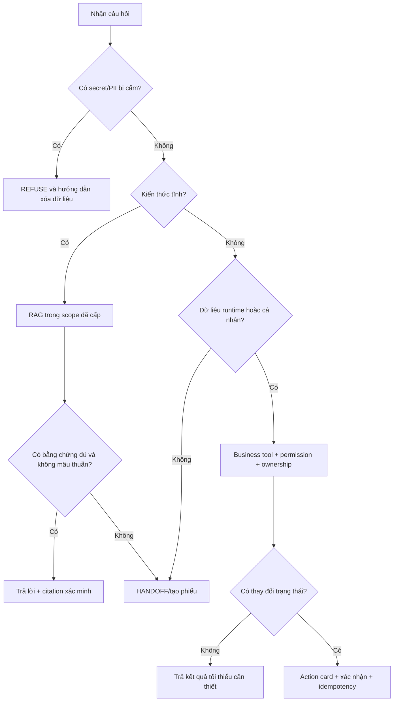

# Bản đồ năng lực nghiệp vụ cho chatbot

> Cập nhật đợt 1 — 19/11/2026: xem [bằng chứng/truy vết](evaluation/batch-01-traceability.md), [manifest](knowledge-manifest.json) và [báo cáo đợt 1](evaluation/batch-01-report.md). Baseline 14/09/2026 được giữ để truy vết; các nhận định runtime có delta dưới đây thay thế nhận định cũ tương ứng. Chưa tự phê duyệt/publish knowledge.

| ID | Miền | Actor | Năng lực hệ thống hiện có | Chatbot được giải thích | Chatbot được đọc qua tool | Ghi cần xác nhận | Không được làm | Trạng thái |
|---|---|---|---|---|---|---|---|---|
| CAP-01 | Xác thực/hồ sơ | Khách, Keycloak, quản trị duyệt | Register, resend verify, forgot password, OAuth bootstrap, onboarding/profile/avatar | Cách đăng ký, đăng nhập, reset và hoàn thiện hồ sơ | Trạng thái hồ sơ/tài khoản OWN — tool đề xuất | Cập nhật hồ sơ/avatar — tool tương lai | Nhận password/OTP/token; tự duyệt | PARTIAL |
| CAP-02 | Phương tiện | Khách hàng, quản trị | CRUD, active/inactive/block/default, ownership | Điều kiện và thao tác trên UI | Danh sách/chi tiết xe OWN — tool đề xuất | Thêm/sửa/ngừng dùng/default | Đọc/sửa xe người khác; tự unblock | PARTIAL |
| CAP-03 | Subscription | Khách, người duyệt, thu ngân | Create, approve/reject, invoice, payment, assign card, cancel, expire | Vòng đời và điều kiện | `get_my_subscription_status` hiện có | Tạo/cancel — tool tương lai | Tự approve/reject/assign card | PARTIAL |
| CAP-04 | Pricing | Khách, quản lý giá | Public price plan/rule/type | Khái niệm và giá đã retrieval tại thời điểm hỏi | Public pricing tool đề xuất | Không | Bịa giá hoặc bảo đảm giá tương lai | PARTIAL |
| CAP-05 | Invoice/payment | Khách, thu ngân, VNPAY | Invoice, manual payment, VNPAY create/IPN/return | Quy trình và lỗi phổ biến | Invoice/payment OWN — tool đề xuất | Khởi tạo VNPAY sau xác nhận | Tự đánh dấu paid/refund; nhận số thẻ/CVV | PARTIAL |
| CAP-06 | Parking in/out | Nhân viên vận hành, OCR | Check-in/out, prepare visitor checkout, complete paid checkout | Quy trình chung | Trạng thái session OWN — tool đề xuất | Không cho chatbot khách hàng | Mở barrier, check-in/out, sửa OCR | READ ONLY |
| CAP-07 | Card/lost card | Nhân viên, khách | Card lifecycle, lost-card report ALL | Hướng dẫn báo mất và xác minh tại quầy | Trạng thái thẻ OWN chưa có tool phù hợp | Tạo yêu cầu hỗ trợ thay vì lost-card action | Thu CCCD đầy đủ; block/recover/retire | HANDOFF |
| CAP-08 | Parking history | Khách hàng | `/parking-sessions/me` và FE history | Cách xem lịch sử | History OWN — tool đề xuất | Không | Đọc lịch sử người khác | PARTIAL |
| CAP-09 | Support | Khách, assignee, reviewer | Ticket, chat, claim/assign/reopen/close, escalation/reassign | Vòng đời và quyền của khách | get/list ticket hiện có | create ticket hiện có; reopen/escalate đề xuất | Tự đóng/resolve/assign; bỏ qua reviewer independence | PARTIAL |
| CAP-10 | Privacy | Mọi actor, Security/Privacy Owner | Redaction cơ bản, payload redacted | Dữ liệu nào không được gửi | Không | Không | Lưu/echo secret/PII hoặc gửi sang model | PARTIAL |
| CAP-11 | Troubleshooting | Khách, support | Error mapping, assistant retry/failed | Bước tự kiểm tra an toàn | Status tool theo miền | Retry action có kiểm soát | Khẳng định nguyên nhân khi thiếu log | PARTIAL |
| CAP-12 | Location/SLA/contact | Khách, Business Owner | FE static contact chưa đồng bộ, contact API chưa có | Chỉ nội dung đã phê duyệt và publish chính thức | Location/contact tool đề xuất | Không | Bịa hoặc dùng dữ liệu FE cũ làm nguồn | APPROVED_POLICY / IMPLEMENTATION_PENDING |

## Phân loại dữ liệu

| Loại | Ví dụ | Nguồn | Cách trả lời |
|---|---|---|---|
| Kiến thức tĩnh | Quy trình đăng ký, ý nghĩa trạng thái | Knowledge document đã publish | RAG + citation |
| Reference runtime công khai | Bảng giá đang hiệu lực, loại vé | API/catalog DB | BUSINESS_TOOL; có thể kèm citation quy trình |
| Dữ liệu cá nhân | Xe, vé, hóa đơn, lịch sử, phiếu của tôi | Business aggregate + access guard | BUSINESS_TOOL + ownership |
| Thao tác ghi | Tạo phiếu, hủy vé, cập nhật hồ sơ | Use case hiện hữu | ACTION_CARD + confirm + idempotency |
| Dữ liệu cấm | Password, OTP, token, CVV, full card number | Không lưu trong RAG | REFUSE + hướng dẫn xóa dữ liệu |

## Actor và trách nhiệm

- `PUBLIC`: xem hướng dẫn và bảng giá công khai, không có dữ liệu cá nhân.
- `CUSTOMER`: đọc OWN, đề xuất write OWN và xác nhận.
- `EMPLOYEE`: xử lý nghiệp vụ theo permission assigned/all; không mặc định vì tên role.
- `ADMIN`: quản trị theo permission; không đồng nghĩa mọi admin đều có mọi quyền.
- `Knowledge Steward`: upload/edit metadata khi có `AI_KNOWLEDGE_MANAGE_ALL`.
- `Knowledge Approver`: publish/archive khi có permission approve được chốt ở phase sau.
- `Reviewer`: xử lý escalation, phải độc lập với assignee hiện tại/nguyên thủy.
- `Backend`: source of authorization, ownership, idempotency, citation allowlist và audit.
- `Frontend`: hiển thị theo permission, không phải security boundary.

## Luồng quyết định chatbot

## Capability bổ sung đợt 1

- Hướng dẫn tài khoản/riêng tư/kênh chat/phiếu: RAG theo nguồn đủ và scope.
- Hỏi lại thiếu chủ đề: deterministic clarification, không ghi.
- Followup: chủ đề hướng dẫn gần nhất cùng phiên/actor; không tái chạy action cá nhân.
- Tra cứu profile/account thực tế: chưa có tool, hướng dẫn UI/handoff.
- Hỗ trợ khách–đối tác: không gửi phiếu cho nhau; chia sẻ đơn hàng là chức năng chat riêng có quyền.
