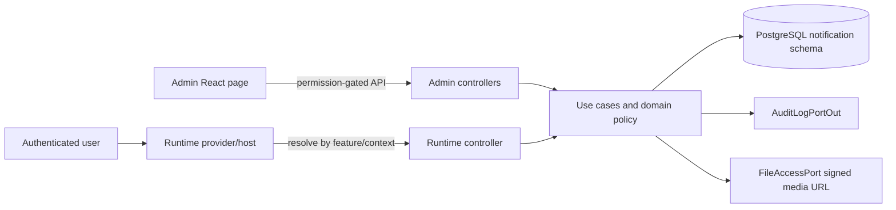
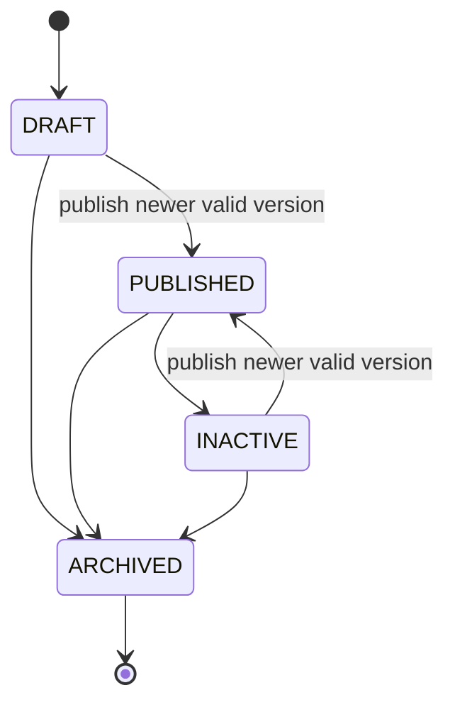

# User Guide API and operation guide

## Scope

The module manages contextual product guides from draft creation through publication and runtime delivery. All endpoints require an authenticated account. Administrative endpoints also enforce the named permission in both Spring Security and the application service.

The normal response envelope is:

```json
{
  "success": true,
  "message": "...",
  "data": {},
  "timestamp": "2026-10-16T08:00:00Z"
}
```

## Architecture and flow





## Permissions

| Permission | Purpose |
|---|---|
| `USER_GUIDE_CREATE_ALL` | Create a feature or guide |
| `USER_GUIDE_READ_ALL` | Read admin guide/feature/version data |
| `USER_GUIDE_UPDATE_ALL` | Update feature/guide metadata and drafts |
| `USER_GUIDE_PUBLISH_ALL` | Publish a version |
| `USER_GUIDE_ARCHIVE_ALL` | Archive a guide |

The permission seed assigns these permissions only to `SYSTEM_ADMIN`. Runtime endpoints use `isAuthenticated()` and then evaluate audience and replay rules against the account loaded from the security context; they never trust an account ID from the client.

## Administrative endpoints

### Features

| Method | Path | Permission | Notes |
|---|---|---|---|
| `POST` | `/api/notifications/user-guide-features` | CREATE | Create a feature |
| `GET` | `/api/notifications/user-guide-features` | READ | Filters: `enabled`, `keyword`, pageable parameters |
| `GET` | `/api/notifications/user-guide-features/{featureId}` | READ | Feature detail |
| `PUT` | `/api/notifications/user-guide-features/{featureId}` | UPDATE | Update feature metadata/enabled flag |

### Guides and versions

| Method | Path | Permission | Notes |
|---|---|---|---|
| `POST` | `/api/notifications/user-guides` | CREATE | Create guide plus version 1 draft |
| `GET` | `/api/notifications/user-guides` | READ | Filters: `featureId`, `status`, `displayType`, `keyword`, pageable parameters |
| `GET` | `/api/notifications/user-guides/{guideId}` | READ | Guide metadata and `lockVersion` |
| `PUT` | `/api/notifications/user-guides/{guideId}` | UPDATE | Requires the latest `lockVersion` |
| `POST` | `/api/notifications/user-guides/{guideId}/versions` | UPDATE | Create a new draft, optionally clone a version |
| `GET` | `/api/notifications/user-guides/{guideId}/versions` | READ | Versions newest first |
| `GET` | `/api/notifications/user-guides/{guideId}/versions/{versionNumber}` | READ | Version detail |
| `PUT` | `/api/notifications/user-guides/{guideId}/versions/{versionNumber}` | UPDATE | Update an unpublished version; requires guide `lockVersion` |
| `POST` | `/api/notifications/user-guides/{guideId}/versions/{versionNumber}/publish` | PUBLISH | Transactional publish with a pessimistic guide-row lock |
| `POST` | `/api/notifications/user-guides/{guideId}/archive` | ARCHIVE | Terminal archive transition |

Create-guide example:

```json
{
  "featureCode": "VEHICLE_ENTRY",
  "code": "VEHICLE_ENTRY_FIRST_USE",
  "contextKey": "VEHICLE_LIST",
  "displayType": "TOUR",
  "replayPolicy": "ONCE_PER_VERSION",
  "priority": 10,
  "displayOrder": 10,
  "startAt": "2026-10-16T00:00:00Z",
  "endAt": null,
  "initialVersion": {
    "title": "Tạo phương tiện đầu tiên",
    "summary": "Các bước cơ bản",
    "deepLink": "/vehicles",
    "audienceMode": "ALL_AUTHENTICATED",
    "steps": [
      {
        "displayOrder": 0,
        "title": "Mở biểu mẫu",
        "body": "Chọn nút Thêm phương tiện.",
        "mediaObjectKey": null,
        "anchorKey": "vehicle-create-button",
        "placement": "BOTTOM",
        "collapseMs": 0
      }
    ],
    "audiences": []
  }
}
```

`featureId` or `featureCode` must identify an existing feature. `lockVersion` is returned on guide reads and must be echoed by metadata/draft updates. A stale value returns `USER_GUIDE_OPTIMISTIC_LOCK_CONFLICT`.

## Runtime endpoints

| Method | Path | Purpose |
|---|---|---|
| `GET` | `/api/user-guides/resolve?featureCode=...&contextKey=...` | Resolve published, enabled, scheduled, eligible and replayable guides |
| `GET` | `/api/user-guides/{guideCode}` | Read one eligible published guide by code |
| `POST` | `/api/user-guides/{guideId}/events` | Record `STARTED`, `STEP_VIEWED`, `COMPLETED`, or `DISMISSED` |

Event example:

```json
{
  "event": "STEP_VIEWED",
  "versionNumber": 2,
  "stepId": "a936243b-5048-4e20-8e38-322cfa626712"
}
```

`versionNumber` is mandatory and must equal the currently published version. This prevents an old browser tab from overwriting progress after an administrator publishes a newer version. First-event state creation is an atomic PostgreSQL `INSERT ... ON CONFLICT DO NOTHING`, followed by a locked update.

## Business rules

- Feature must be enabled; guide must be `PUBLISHED` and inside `[startAt, endAt]`.
- Publish only accepts a version newer than `currentVersion`, validates all steps/audiences and records publisher/time.
- Published versions are immutable; editors create a newer draft.
- Step order is non-negative and unique, with 1–50 steps per version.
- Step title is limited to 255 characters, body to 10,000, summary to 5,000 and media key to 500.
- `deepLink` must be an internal path beginning with one `/`; external schemes, protocol-relative links and backslashes are rejected.
- Media input is an object key, never a URL. Runtime output uses a short-lived signed URL from `FileAccessPort`.
- `ROLE`, `PERMISSION_ANY`, and `PERMISSION_ALL` require valid existing targets. `PUBLIC` and `ALL_AUTHENTICATED` accept no target rows.
- Replay policy is evaluated only on the server from the account's persisted state.
- Audit writes share the business transaction. An audit persistence failure rolls the mutation back (fail closed).

## Frontend integration

- Admin route: `/admin/user-guides`; menu/route/action visibility follows permissions.
- Runtime route: `/guide/:code`; it still requires login.
- `UserGuideBackendHost` is mounted in both authenticated layouts and resolves guides by route context.
- Add `data-guide-anchor="<anchorKey>"` through `UserGuideAnchor` to target an element.
- If an anchor is absent, the renderer falls back to a centered modal instead of blocking the user.
- Lifecycle event failures are non-fatal to the UI; the next event can retry state progression.

## Cache decision

No Redis cache is enabled in this phase. Runtime eligibility depends on the current account's roles, permissions, replay state and current version. Database access is indexed and avoids N+1 fetches. Introduce cache only after measured need, with a key including guide/current version and a user-eligibility dimension; evict on feature update, guide update, publish, archive and user-state mutation.

## Local verification

Backend:

```powershell
cd C:\DiskD\VehicleManagementProject\vehicle-management-backend\vehicle-management
.\mvnw.cmd test
```

Frontend:

```powershell
cd C:\DiskD\VehicleManagementProject\vehicle-management-frontend\vehicle_management_react
npm test
npm run build
```

Manual smoke flow:

1. Sign in as `SYSTEM_ADMIN` and open `/admin/user-guides`.
2. Create/enable a feature, then create a guide with one valid step.
3. Publish version 1 and confirm the guide is returned by `/api/user-guides/resolve` in its context.
4. Open the target page, step through the guide, refresh and confirm resume/replay behavior.
5. Create version 2, publish it, then submit a version-1 event and confirm it is rejected.
6. Archive the guide and confirm it no longer resolves at runtime.


